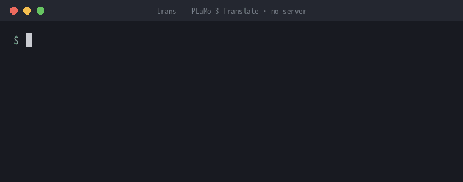

# plamo-trans

**Local translation as a Unix filter.** `trs` runs
[PLaMo 3 Translate](https://huggingface.co/pfnet/plamo-3-translate-31b) (Preferred Networks) on
[llama.cpp](https://github.com/ggml-org/llama.cpp) with no server: start, translate, exit — in about half a second with the 0.8B model.

(Japanese: [README_jp.md](README_jp.md))

<p align="center">
  
</p>

```sh
wl-paste | trs | wl-copy               # translate the clipboard (Wayland)
git log -1 --format=%B | trs -t ja     # read a commit message in Japanese
trs -ff < notes.txt | less             # stream a file into a pager
```

| Model | One sentence, start → exit | Decode speed |
| --- | --- | --- |
| 0.8B (`-ff`) | ~0.5 s | — |
| 2B (`-f`) | ~0.75 s | — |
| 8B (default) | ~1.2 s | 45 tokens/s |
| 31B (`-d`) | 4–5 s | 12.5 tokens/s |

<sub>NVIDIA RTX Spark N1X, Linux arm64, CUDA 13.4, model file in the page cache.</sub>

**Why no server?** A resident model server is fast once it is warm, but it holds RAM and VRAM all day and has to be
started, watched and restarted. plamo-trans makes the cold start fast instead: the PLaMo tokenizer table is built
in 0.2 s instead of 0.76 s, CUDA start-up overlaps with it, weights are read with many threads, and the process never
waits for GPU teardown on exit. When you are not translating, nothing is running.

## Quick start

```sh
brew install ikegam/tap/plamo-trans      # macOS (Apple Silicon) / Linux
yay -S plamo-trans                       # Arch Linux (AUR)
trs --download 0.8b                      # 0.6 GB — read the PLaMo Community License first
trs -ff 吾輩は猫である。
```

Prebuilt binaries (Linux x86_64/arm64, macOS arm64) are on the [releases page](https://github.com/ikegam/plamo-trans/releases):
a single `trs` executable, copy it anywhere on your `PATH`. To build from source (needed for CUDA/Vulkan):

```sh
git clone https://github.com/ikegam/plamo-trans && cd plamo-trans
cargo build --release                    # CPU (Metal on macOS); --features cuda or --features vulkan for GPU
install target/release/trs ~/.local/bin/
```

> The command is named `trs` so that it does not clash with `trans` from
> [translate-shell](https://github.com/soimort/translate-shell).

Details: [The model is not included](#the-model-is-not-included), [Build](#build), [Usage](#usage).

## What it does

```
$ trs 吾輩は猫である。名前はまだ無い。
I am a cat. I have no name yet.
$ echo "Please let me know if you have any questions." | trs -p
ご質問があればお知らせください。
$ trs -t zh-hans 今日はいい天気ですね
今天天气很好呢
```

- Direction is chosen automatically: input with kana is translated into English, anything else into Japanese.
  Use `-t` for other languages.
- Output is streamed as it is generated (greedy decoding).
- Ctrl-C returns to the shell at once. The work runs in a forked child; the parent, which the shell waits for,
  never touches CUDA, so neither Ctrl-C nor a normal exit waits for the kernel to tear down the GPU state.
- Written in Rust. It calls `libllama` directly; the only C is a tiny shim that fills llama.cpp's parameter structs.

## Design

plamo-trans is meant to be one more filter in a Unix pipeline, so it is built around three rules:

1. **Text in, text out.** Text comes from the arguments or stdin, the translation goes to stdout and nothing else
   does: logs stay off unless `-v` is given, errors go to stderr, and the exit code says what happened. Translation
   is streamed, so the next command in the pipeline starts receiving text right away.

2. **Fast.** There is no server to start or keep running, so every run pays the whole start-up cost, and the
   start-up is where the work went: the tokenizer table is built 4x faster, CUDA start-up runs in parallel with it,
   weights are read with many threads, and the process does not wait for GPU teardown on exit. A sentence takes
   about 0.5 s with `-ff` and 1.2 s with the default 8B model.

3. **Stops at once.** Ctrl-C returns to the shell immediately, and when the reader goes away (`| head`, a closed
   pager) generation stops at the next token and the exit code is 141, as for any tool killed by SIGPIPE. If the
   process is killed, the worker that holds the GPU goes with it.

Exit codes: `0` done, `1` error (message on stderr), `2` bad usage, `130` interrupted, `141` reader closed.

## The model is not included

This repository contains no model weights. Download them yourself from Hugging Face and **read the
[PLaMo Community License](https://huggingface.co/pfnet/plamo-3-translate-31b-GGUF) first** (personal and
non-commercial use is free; commercial use needs registration or a separate agreement depending on revenue).

```sh
trs --download 8b                      # 8B  Q4_K_M (5.3 GB), the default
trs --download 2b                      # 2B  Q4_K_M (1.8 GB), for -f
trs --download 0.8b                    # 0.8B Q4_K_M (0.6 GB), for -ff
trs --download 31b                     # 31B Q4_K_M (19.5 GB), for -d
trs --download 8b Q3_K_M               # another quantisation
```

(`scripts/download-model.sh` does the same; it is embedded in the binary.) You only need the sizes you use. The files go to `${XDG_DATA_HOME:-~/.local/share}/plamo-trans/`. Downloads resume after interruption and the
SHA-256 is checked against Hugging Face.

## Build

Requirements: a C/C++ toolchain, CMake, Rust (edition 2024), and the CUDA toolkit or Vulkan SDK if you want GPU
offload.

```sh
cargo build --release                    # CPU only (Metal on macOS)
cargo build --release --features cuda    # NVIDIA
cargo build --release --features vulkan  # Vulkan
```

The result is one self-contained executable, `target/release/trs`: llama.cpp is linked statically. It is built for
the CPU of the machine you build on; set `PLAMO_PORTABLE=1` for a baseline CPU (x86-64-v3), as the release binaries
are. Extra CMake options can be passed in `PLAMO_CMAKE_ARGS`, e.g. `PLAMO_CMAKE_ARGS=-DCMAKE_CUDA_ARCHITECTURES=121`.

llama.cpp is not part of this repository. On the first build, `scripts/fetch-llama.sh` downloads the commit named
in `llama.cpp.commit` into `./llama.cpp` (only that commit and only the directories needed, a few seconds) and
applies the patches in `patches/`. To try another commit, change `llama.cpp.commit` (or run
`scripts/fetch-llama.sh COMMIT`). The patches only make start-up faster:

- `0001`: llama.cpp's PLaMo tokenizer builds a ~960k-row lookup table on every load. Rewritten with string views
  and threads: 0.76 s → 0.2 s, with an identical table.
- `0002`: backend/device setup (CUDA start-up, ~0.2 s) runs in parallel with reading the vocabulary and building the
  tokenizer instead of before it.
- `0003`: weights are read in larger chunks (up to 64 MiB) with several threads before the async upload to the GPU.

## Releasing

1. Bump `version` in `Cargo.toml`, commit, and push a tag: `git tag v0.2.0 && git push origin v0.2.0`.
2. The Release workflow builds the binaries, attaches them with a source tarball and `SHA256SUMS` to a GitHub
   release, and updates the Homebrew tap (`ikegam/homebrew-tap`, secret `HOMEBREW_TAP_DEPLOY_KEY`) and the AUR package
   (`plamo-trans`, secret `AUR_SSH_KEY`). Without the secrets, run `packaging/update.sh VERSION SHA256SUMS` and
   publish `packaging/homebrew/plamo-trans.rb` and `packaging/aur/{PKGBUILD,.SRCINFO}` by hand.

## Usage

```
trs [options] [text...]         text from stdin when no text argument is given
  -t LANG   target language (default: en if the input contains kana, else ja)
  -s LANG   source language (default: detected by the model)
  -p / -P   polite / plain Japanese      -e  easy Japanese (ja(easy))
  -c TEXT   context: reference text that is not translated
  -g FILE   glossary, one "source<TAB>target" per line
  -ff       0.8B model (fastest)     -f  2B (fast)     -d  31B (deep)
  -m FILE   model file (overrides the size options)
  -v        llama.cpp logs and timings on stderr
  --download SIZE [QUANT]   download a model from Hugging Face
  -V        version
```

Without a size option the 8B model is used (or `$PLAMO_MODEL` if set). If 8B is not installed, the nearest
installed size is used instead (2B, 31B, 0.8B in that order) with a note on stderr. A size option asks for exactly
that size and tells you how to download it when it is missing. For each size, Q4_K_M is preferred, then any other
quantisation found in the data directory.

Language codes are lowercase, e.g. `en ja zh-hans zh-hant ko fr de es it pt ru`.

The prompt is the model's PFML3 translation format, built the same way as the `chat_template.jinja` shipped with the
GGUF. Input and output together are limited to the model's 32K-token training length.

## Notes

- Tested on Linux arm64 (NVIDIA RTX Spark N1X, CUDA 13.4). With the model file in the page cache, one sentence
  (start, translate, exit) takes about 0.5 s with 0.8B, 0.75 s with 2B, 1.2 s with 8B (45 tokens/s) and 4–5 s
  with 31B (12.5 tokens/s). The fixed part is mostly CUDA start-up (0.2 s, now overlapped with the tokenizer); for
  8B, copying the weights to the GPU adds about 0.45 s.
- llama.cpp's C API changes often. If you move to another llama.cpp commit and it fails to compile or link, go back
  to the pinned commit.

## License

The source code is under the 4-clause BSD license; see [LICENSE](LICENSE). llama.cpp (MIT) is downloaded at build
time and linked into the binary; its license is shipped with the packages as `LICENSE.llama.cpp`. The PLaMo 3 Translate models are under the PLaMo Community License.

This tool is not affiliated with Preferred Networks.
