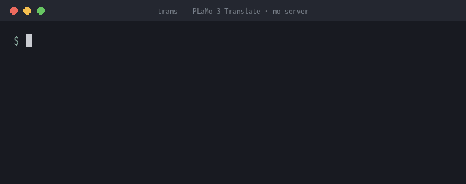

# plamo-trans

**翻訳を Unix のフィルターに。** `trs` は Preferred Networks の
[PLaMo 3 Translate](https://huggingface.co/pfnet/plamo-3-translate-31b) を
[llama.cpp](https://github.com/ggml-org/llama.cpp) で動かす翻訳コマンドです。サーバーは常駐せず、
起動・翻訳・終了までが 0.8B モデルなら約 0.5 秒で終わります。

(English: [README.md](README.md))

<p align="center">
  
</p>

```sh
wl-paste | trs | wl-copy               # クリップボードの文章を訳す(Wayland)
git log -1 --format=%B | trs -t ja     # コミットメッセージを日本語で読む
trs -ff < notes.txt | less             # ファイルを訳しながらページャーで読む
```

| モデル | 1 文(起動から終了まで) | 生成速度 |
| --- | --- | --- |
| 0.8B(`-ff`) | 約 0.5 秒 | — |
| 2B(`-f`) | 約 0.75 秒 | — |
| 8B(既定) | 約 1.2 秒 | 45 トークン/秒 |
| 31B(`-d`) | 4〜5 秒 | 12.5 トークン/秒 |

<sub>NVIDIA RTX Spark N1X、Linux arm64、CUDA 13.4、モデルファイルがページキャッシュに載った状態で計測。</sub>

**なぜサーバーを使わないのか。** 常駐サーバーは温まっていれば速いものの、メモリと VRAM を一日中占有し、
起動・監視・再起動の手間もかかります。plamo-trans は代わりに起動そのものを速くしました。PLaMo のトークナイザーの
表作りを 0.76 秒から 0.2 秒に縮め、CUDA の起動をそれと並行させ、重みを複数のスレッドで読み、終了時に GPU の
後片付けを待ちません。翻訳していないときは、何も動いていません。

## すぐに試す

```sh
brew install ikegam/tap/plamo-trans      # macOS(Apple Silicon)/ Linux
yay -S plamo-trans                       # Arch Linux(AUR)
trs --download 0.8b                      # 0.6 GB。先に PLaMo Community License を読んでください
trs -ff 吾輩は猫である。
```

ビルド済みのバイナリ(Linux x86_64/arm64、macOS arm64)は [Releases](https://github.com/ikegam/plamo-trans/releases) にあります。
中身は `trs` という実行ファイル 1 つなので、`PATH` の通った場所に置くだけで使えます。ソースからビルドする場合(CUDA/Vulkan はこちら):

```sh
git clone https://github.com/ikegam/plamo-trans && cd plamo-trans
cargo build --release                    # CPU(macOS では Metal)。GPU は --features cuda か --features vulkan
install target/release/trs ~/.local/bin/
```

> [translate-shell](https://github.com/soimort/translate-shell) の `trans` と被らないよう、コマンド名は `trs` にしています。

詳しくは [モデルは含まれていません](#モデルは含まれていません)、[ビルド](#ビルド)、[使い方](#使い方) を参照してください。

## できること

```
$ trs 吾輩は猫である。名前はまだ無い。
I am a cat. I have no name yet.
$ echo "Please let me know if you have any questions." | trs -p
ご質問があればお知らせください。
$ trs -t zh-hans 今日はいい天気ですね
今天天气很好呢
```

- 翻訳の向きは自動で決まります。入力にかなが含まれていれば英語に、そうでなければ日本語に訳します。
  ほかの言語にするときは `-t` で指定します。
- 訳文は生成した順に表示します(貪欲法でデコードします)。
- Ctrl-C ですぐにシェルへ戻ります。翻訳は fork した子プロセスで行い、シェルが待つ親プロセスは CUDA に触らないので、
  Ctrl-C でも通常の終了でも、カーネルが GPU まわりを片付けるのを待ちません。
- Rust で書いています。`libllama` を直接呼びます。C は、llama.cpp の設定用の構造体に値を入れる小さな中継部分だけです。

## 設計の方針

plamo-trans は、Unix のパイプラインに挟むフィルターの 1 つとして使うことを前提にしています。そのために次の 3 点を守っています。

1. **テキストを受け取り、テキストを返す。** 文章は引数か標準入力から受け取り、標準出力には訳文だけを出します。
   ログは `-v` を付けたときしか出さず、エラーは標準エラーに出し、結果は終了コードで返します。訳文は生成した順に
   流すので、パイプの次のコマンドはすぐに受け取り始められます。

2. **速い。** 常駐サーバーを持たないので、毎回の実行で起動の時間がまるごとかかります。だから起動を詰めました。
   トークナイザーの表作りを約 4 倍速くし、CUDA の起動をそれと並行させ、重みを複数のスレッドで読み、終了時に
   GPU の後片付けを待たないようにしています。1 文の翻訳は `-ff` で約 0.5 秒、既定の 8B で約 1.2 秒です。

3. **すぐ止まる。** Ctrl-C ですぐにシェルへ戻ります。読み手がいなくなったら(`| head` や閉じたページャー)、次の
   トークンで生成を止め、SIGPIPE で止まったほかのコマンドと同じく終了コード 141 で終わります。プロセスが kill
   されれば、GPU を持っている子プロセスも一緒に止まります。

終了コード: `0` 完了、`1` エラー(内容は標準エラー)、`2` 使い方の誤り、`130` 中断、`141` 読み手が閉じた。

## モデルは含まれていません

このリポジトリにモデルの重みは入っていません。Hugging Face から各自でダウンロードしてください。
使う前に **[PLaMo Community License](https://huggingface.co/pfnet/plamo-3-translate-31b-GGUF) を読んでください**
(個人利用と非商用利用は無料です。商用利用は、売上の規模によって登録か個別の契約が必要です)。

```sh
trs --download 8b                      # 8B  Q4_K_M(5.3 GB)。既定で使うモデル
trs --download 2b                      # 2B  Q4_K_M(1.8 GB)。-f 用
trs --download 0.8b                    # 0.8B Q4_K_M(0.6 GB)。-ff 用
trs --download 31b                     # 31B Q4_K_M(19.5 GB)。-d 用
trs --download 8b Q3_K_M               # 別の量子化版
```

(`scripts/download-model.sh` でも同じです。このスクリプトは実行ファイルに埋め込まれています。)使うサイズだけ入れれば十分です。保存先は `${XDG_DATA_HOME:-~/.local/share}/plamo-trans/` です。途中で切れても続きからダウンロードし、
最後に Hugging Face の SHA-256 と照合します。

## ビルド

必要なもの: C/C++ のコンパイラ、CMake、Rust(edition 2024)。GPU を使う場合は CUDA toolkit か Vulkan SDK。

```sh
cargo build --release                    # CPU のみ(macOS では Metal)
cargo build --release --features cuda    # NVIDIA
cargo build --release --features vulkan  # Vulkan
```

できあがるのは単体で動く実行ファイル `target/release/trs` 1 つです(llama.cpp は静的リンク)。ビルドしたマシンの CPU
向けに最適化されます。リリース版と同じく基準的な CPU(x86-64-v3)向けにするには `PLAMO_PORTABLE=1` を指定します。
CMake に追加のオプションを渡すには `PLAMO_CMAKE_ARGS` を使います(例: `PLAMO_CMAKE_ARGS=-DCMAKE_CUDA_ARCHITECTURES=121`)。

llama.cpp はこのリポジトリに含まれていません。最初のビルドで `scripts/fetch-llama.sh` が `llama.cpp.commit` に書かれた
コミットを `./llama.cpp` に取得し(そのコミットの必要なディレクトリだけなので数秒です)、`patches/` のパッチを当てます。
別のコミットを試すには `llama.cpp.commit` を書き換えます(または `scripts/fetch-llama.sh コミット`)。パッチはどれも起動を速くするためのものです。

- `0001`: llama.cpp の PLaMo トークナイザーは、読み込みのたびに約 96 万行の検索表を作ります。この処理を
  string_view とスレッドで書き直しました。出来上がる表は同じまま、0.76 秒が 0.2 秒になります。
- `0002`: 計算装置の準備(CUDA の起動、約 0.2 秒)を、語彙の読み込みとトークナイザーの準備の前ではなく、同時に行います。
- `0003`: 重みを GPU に送る前の読み込みを、大きめのチャンク(最大 64 MiB)で、複数のスレッドで行います。

## リリース

1. `Cargo.toml` の `version` を上げてコミットし、タグを push します: `git tag v0.2.0 && git push origin v0.2.0`
2. Release ワークフローがバイナリをビルドし、ソースの tarball と `SHA256SUMS` と一緒に GitHub のリリースに添付します。
   続けて Homebrew の tap(`ikegam/homebrew-tap`、シークレット `HOMEBREW_TAP_DEPLOY_KEY`)と AUR のパッケージ
   (`plamo-trans`、シークレット `AUR_SSH_KEY`)も更新します。シークレットがない場合は `packaging/update.sh バージョン SHA256SUMS`
   を実行し、`packaging/homebrew/plamo-trans.rb` と `packaging/aur/{PKGBUILD,.SRCINFO}` を手で公開します。

## 使い方

```
trs [オプション] [文章...]       文章を引数で渡さなければ標準入力から読みます
                                （端末では1行入力して Enter で翻訳）
  -t 言語    訳し先の言語(既定: 入力にかながあれば en、なければ ja)
  -s 言語    原文の言語(既定: モデルが判断)
  -p / -P    丁寧体 / 常体の日本語      -e  やさしい日本語(ja(easy))
  -c 文章    文脈: 訳さずに参考として渡す文章
  -g ファイル 用語集。1 行に「原語<TAB>訳語」
  -ff        0.8B モデル(最速)     -f  2B(速い)     -d  31B(じっくり)
  -m ファイル モデルのファイル(サイズの指定より優先)
  -v         llama.cpp のログと所要時間を標準エラーに出す
  --download サイズ [量子化]   Hugging Face からモデルをダウンロード
  -V         バージョン
```

サイズを指定しなければ 8B を使います(`$PLAMO_MODEL` があればそれを使います)。8B が入っていなければ、
入っている中で近いサイズ(2B、31B、0.8B の順)を使い、標準エラーにその旨を出します。サイズを指定したときはそのサイズだけを使い、
入っていなければダウンロードの方法を表示します。各サイズでは Q4_K_M を優先し、なければデータディレクトリにある別の量子化版を使います。

言語コードは小文字で指定します(例: `en ja zh-hans zh-hant ko fr de es it pt ru`)。

プロンプトはモデルの翻訳用形式 PFML3 で、GGUF に付いている `chat_template.jinja` と同じ組み立て方です。
入力と出力を合わせて、モデルの学習時の長さ 32K トークンまでです。

## 補足

- Linux arm64(NVIDIA RTX Spark N1X、CUDA 13.4)で動作を確認しています。モデルのファイルがページキャッシュに
  載っていれば、起動・1 文の翻訳・終了までが 0.8B で約 0.5 秒、2B で約 0.75 秒、8B で約 1.2 秒(毎秒 45 トークン)、
  31B で 4〜5 秒(毎秒 12.5 トークン)です。固定でかかる時間の大半は CUDA の起動(0.2 秒、トークナイザーの準備と並行)で、
  8B では重みを GPU に写すのにさらに約 0.45 秒かかります。
- llama.cpp の C API はよく変わります。別の版の llama.cpp でビルドやリンクに失敗したら、固定したコミットに戻してください。

## ライセンス

ソースコードは 4 条項 BSD ライセンスです([LICENSE](LICENSE))。llama.cpp(MIT)はビルド時に取得して
実行ファイルにリンクします。そのライセンスはパッケージに `LICENSE.llama.cpp` として同梱しています。PLaMo 3 Translate のモデルは PLaMo Community License です。

このツールは Preferred Networks とは関係ありません。
